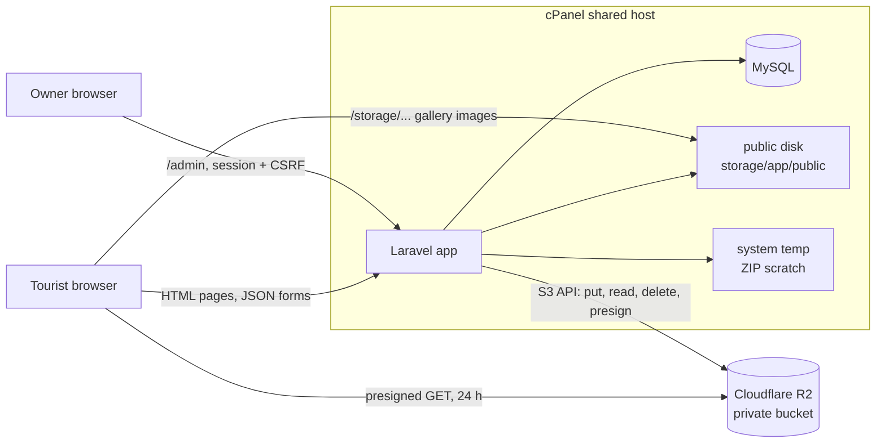
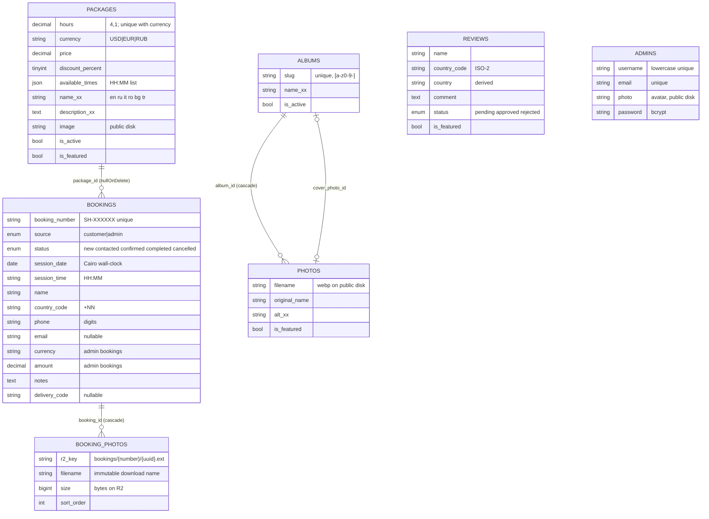

# Sharm4You — Architecture

This document describes how the system is built and why. For what it does, see [REQUIREMENTS.md](REQUIREMENTS.md).

## 1. Overview

A single Laravel 12 monolith. Blade renders every page on the server, and small inline Alpine.js components add interactivity. There is no frontend build step except the Tailwind CLI, which compiles `resources/css/app.css` into `public/css/app.css`.

Two separate storage systems are used on purpose:

- **Public disk** (`storage/app/public`, served through the `public/storage` symlink): marketing content (gallery albums, package images, admin avatar). Anyone with a URL can view these files.
- **R2 private bucket**: tourist delivery photos. These never go through the web root. They are reached only through short-lived presigned URLs created after the booking number and access code have been verified.

## 2. Code map

| Path | Responsibility |
| --- | --- |
| `routes/web.php` | Public routes: unprefixed (`en`) group plus the `{locale}` prefixed group, and retired-prefix redirects |
| `routes/admin.php` | `/admin` routes, loaded under `web` middleware from `bootstrap/app.php` |
| `bootstrap/app.php` | Middleware aliases, guest redirect, delivery-error privacy headers, `delivery_code` excluded from flashed input |
| `app/Providers/AppServiceProvider.php` | Named rate limiters |
| `app/Http/Controllers/*` | Public pages, booking, reviews, photo delivery |
| `app/Http/Controllers/Admin/*` | Admin auth, profile, bookings and delivery uploads, gallery, packages, reviews |
| `app/Http/Requests/**` | All validation (form requests). Normalization only touches values that are strings |
| `app/Http/Middleware` | `SetLocale`, `SetAdminLocale` (forces `en`), `AdminMiddleware` (admin guard), `PrivatePhotoHeaders` |
| `app/Rules` | `AlbumName` (meaningful name, safe punctuation), `SafeImage` (dimension and memory check before decoding) |
| `app/Support/PhotoStorage.php` | Checked storage writes, moves and deletes: a failure becomes a 503 error instead of a silent `false` |
| `app/Support/DeliveryArchive.php` | Streamed, size-bounded ZIP builder |
| `app/Helpers/locale.php` | `localized_url()`, `locale_prefixes()`, `alternate_urls()`, … (autoloaded) |
| `config/booking.php` | Business timezone (`Africa/Cairo`), contact-field limits |
| `config/photo_delivery.php` | Delivery and image limits (see REQUIREMENTS §6) |
| `config/locales.php`, `config/currencies.php`, `config/countries.php` | Locales, locale → currency map, dial codes and countries |
| `resources/views/partials/booking-form-scripts.blade.php` | Shared Alpine `bookingForm` component (inline and popup forms) |
| `resources/views/partials/alpine-toast-store.blade.php` | Global Alpine toast store used by the public site and admin |
| `lang/{locale}/site.php` | Public UI strings and validation messages for six locales |

## 3. Data model

Notes:

- A package **tier** is the set of rows sharing one `hours` value, one row per currency. Admin tier routes address the tier by `hours` (`/admin/packages/tier/{hours}`), and tier writes update all three rows in one transaction.
- Bookings never store prices; they are contact requests (see REQUIREMENTS §1). `currency`/`amount` exist only for owner-recorded ad-hoc bookings.
- `users`, `jobs`, `cache` and `sessions` come from the Laravel skeleton. Sessions, cache and rate-limiter counters use the database store, and `users` is unused.

## 4. Request handling

### Middleware and guards

- Public routes: `web` → `locale` (sets the app locale from the `{locale}` segment, defaulting to `en`).
- Delivery routes additionally use `private.photos`, which sends `Cache-Control: private, no-store` and `X-Robots-Tag: noindex, nofollow`. The exception handler adds the same headers to delivery error responses.
- Admin routes: `web` → `admin.locale` (forces `en`) → `guest:admin` (login) or `auth.admin` (everything else). Unauthenticated JSON requests get 401; browser requests are redirected to `/admin/login`.
- CSRF is Laravel's default `web` protection. All AJAX calls send `X-CSRF-TOKEN` from the page's meta tag.

### Rate limiters (`AppServiceProvider`)

| Name | Limit | Key |
| --- | --- | --- |
| `admin-login` | 5/min **and** 20/min | SHA-256 of the normalized username + IP; IP alone |
| `bookings` | 3/min | IP |
| `reviews` | 3/min | IP |
| `photo-lookup` | 5/min | IP |
| `photo-zip` | 3/min | IP |

Each limiter is shared by the unprefixed and locale-prefixed routes of the same operation, but kept separate from other operations. Counters live in the cache store, which must be persistent in production (`database`).

### JSON endpoint conventions

These are session-backed web endpoints, not a public API. Every JSON endpoint follows the same conventions:

- Success: `200 {"success": true, "message": "...", ...resource}`
- Validation: `422 {"message": "...", "errors": {"field": ["..."]}}` (standard Laravel)
- Business errors: `422`/`503 {"success": false, "message": "..."}`
- Others: `401` (no admin session), `403` (e.g. editing a tourist booking), `419` (CSRF/session expired), `429` (throttled, with `Retry-After`)

The frontends show `message` in a toast and map `errors` onto fields.

### Public endpoints

| Method & path | Purpose | Response |
| --- | --- | --- |
| `GET /`, `/about`, `/services`, `/gallery`, `/gallery/{slug}` (+ `/{locale}/…`) | Pages | HTML |
| `POST /book-session` | Booking request (`StoreBookingRequest`) | JSON |
| `POST /review` | Review submission (stored as `pending`) | JSON |
| `GET /my-photos` | Lookup form | HTML |
| `POST /my-photos` | Lookup (`LookupPhotosRequest`) | HTML (gallery or form with error) |
| `POST /my-photos/download-all` | ZIP of all photos | binary `application/zip` or JSON error |
| `GET /up` | Health check | 200 |

### Admin endpoints (all under `/admin`, all JSON except page `GET`s)

| Area | Routes |
| --- | --- |
| Auth | `GET/POST /login`, `POST /logout` |
| Profile | `GET /profile`, `PUT /profile`, `PUT /profile/password` |
| Bookings | `GET /bookings`, `POST /bookings` (ad-hoc), `GET /bookings/{id}`, `PUT /bookings/{id}` (admin bookings only), `PATCH /bookings/{id}/status`, `PUT /bookings/{id}/notes` |
| Delivery | `POST /bookings/{id}/photos` (one file), `DELETE /bookings/photos/{photo}`, `PATCH /bookings/{id}/delivery` (generate code) |
| Gallery | `GET/POST /gallery`, `PUT/DELETE /gallery/{album}`, `PATCH /gallery/{album}/toggle`, `GET/POST /gallery/{album}/photos`, `PUT/DELETE /gallery/photos/{photo}`, `PATCH /gallery/photos/{photo}/featured` |
| Packages | `GET/POST /packages`, `PUT/DELETE /packages/tier/{hours}`, `PATCH /packages/tier/{hours}/toggle`, `PATCH /packages/tier/{hours}/featured` |
| Reviews | `GET/POST /reviews`, `PUT/DELETE /reviews/{id}`, `PATCH /reviews/{id}/status`, `PATCH /reviews/{id}/featured` |

There is deliberately no route for deleting bookings.

## 5. Frontend (Blade + inline Alpine)

- Alpine 3.14 (with the `intersect` and `collapse` plugins), Flatpickr (dates), intl-tel-input (phone picker) and Splide (featured slider) are loaded from jsDelivr with pinned versions. Losing the CDN affects the UI, but never what the server accepts. Components are defined inline in Blade partials with `Alpine.data(...)`, and the server passes configuration to them as JSON (`@js(...)`): package slots, Cairo "now", limits, translated messages.
- **The server is authoritative.** Browser validation mirrors the server rules for fast feedback only, and every rule is enforced again by a form request. Slot filtering uses `Intl.DateTimeFormat` with `timeZone: 'Africa/Cairo'`, not the device clock's timezone.
- Forms that submit with AJAX use `novalidate`, so the Alpine validation (inline errors, first-error focus, a single toast) runs instead of the browser's native tooltips.
- The toast store (`$store.toast`) is shared by public pages (localized messages) and admin pages (English).
- Tailwind scans `resources/views/**` **and** `app/Models/**`, because models return status badge classes.
- Frontend logic is tested by extracting the real inline component code from the Blade files and running it in Node with stubs (`tests/Frontend`). This is not a replacement for a real browser check (see docs/TESTING.md).

## 6. Localisation and currency

- `config/locales.php` defines the locales, with `en` as the default and unprefixed. `localized_url($locale, $path)` builds every internal link and keeps the locale prefix. Named routes exist only for the unprefixed group, so code must not call `route(..., ['locale' => …])`.
- Translatable content has one column per locale (`name_en`, `name_ru`, …). Accessors fall back to English.
- `config/currencies.php` maps locale → package currency. The booking request validates that the chosen package is in the current locale's currency.

## 7. Storage design and failure handling

### Public disk (gallery, packages, avatar)

- Images are decoded with Intervention/GD after `SafeImage` has checked dimensions and memory, then re-encoded as WebP.
- `PhotoStorage` wraps every write, move and delete. A `false` result or exception becomes a logged 503 with an English message.
- Gallery batch: files are written, then their rows are inserted in a transaction. If the insert fails, the written files are removed.
- Package image and avatar replacement: the new file is written and saved first, and the old file is removed afterwards. A failed old-file cleanup is reported as a warning rather than undoing the save.
- Album rename moves `albums/{old}` to `albums/{new}` and then saves. If the save fails, the move is reversed. `Album::storagePath()` refuses any slug that isn't `[a-z0-9]+(-[a-z0-9]+)*`, so an empty or unsafe slug can never target `albums/` itself.

### R2 delivery upload (`Admin\BookingController::uploadPhoto`)

1. Validate the file (type, 10 MB, `SafeImage`), check the real MIME type, decode, scale down to 2560 px and encode, all **before** taking any lock.
2. In a DB transaction: lock the booking row (`SELECT … FOR UPDATE`) and check that the count is below 50. Then `put` to R2, then insert `booking_photos`.
3. If anything fails after the R2 write, delete the new object (best effort, logged).

The database and R2 can't commit atomically. The remaining failure window is the case where the database fails **and** the R2 cleanup fails. That leaves an orphan object, which is logged but not visible in the admin.

### Delivery URLs

`BookingPhoto::preview_url` (inline) and `download_url` (attachment with an RFC 6266 UTF-8 filename and ASCII fallback) are generated fresh on each page view with a 24-hour expiry and `private, no-store`. A normal link to an attachment URL is enough to download, so no bucket CORS configuration is needed.

### ZIP lifecycle (`DeliveryArchive`)

1. Reject early if the booking has more than 50 photos or the stored sizes total more than 100 MiB.
2. Create the ZIP with `tempnam()` in the system temp directory.
3. For each photo, stream the R2 object into its own temp file. Bytes are counted during the copy, so a stale stored size can't bypass the budget. Each file is added as `NN-{filename}` with the **store** method; the photos are already compressed, so storing saves CPU on shared hosting.
4. Close the archive and remove the per-photo temp files (in `finally`).
5. Return a `BinaryFileResponse` with `deleteFileAfterSend`. If anything fails before sending, the ZIP is deleted. Any missing object aborts the whole ZIP, so a partial archive is never returned.

The request raises its own time limit to 120 s.

## 8. Security boundaries

| Boundary | Control |
| --- | --- |
| Internet → admin | `admin` guard, session regeneration, layered login throttling, CSRF, English generic errors, no registration route |
| Internet → public forms | Form-request validation (type-checked before normalization), independent throttles, CSRF, status and source fixed by the server |
| Internet → delivery | Booking number + 6-character code from a 31-symbol alphabet (~887 million combinations), checked with `hash_equals` and throttled to 5/min/IP; generic errors; no-store/noindex |
| App → R2 | Scoped API token from `.env`; private bucket; presigned URLs only |
| Upload → GD | Extension, real MIME type, size, and dimension/memory check before decoding |
| Filesystem paths | Slug whitelist, UUID R2 keys, filename validation (no separators or control characters) |
| Output | Blade escaping, Alpine `x-text`, `@js()` for JSON into scripts |

## 9. Dependency decisions

- **Laravel 12 / Tailwind CSS 3 CLI**: kept deliberately. Moving to Vite or Tailwind 4 was out of scope for launch.
- **Intervention Image 3 + GD**: GD is available on shared hosting. Imagick is not required.
- **league/flysystem-aws-s3-v3**: R2 uses Laravel's S3 driver with `use_path_style_endpoint`.
- **No queue/cron**: uploads are one file per request, and ZIP generation is synchronous with a size limit. This fits shared hosting.
- Build tools (`autoprefixer`, `cssnano`, `concurrently`) are pinned dev dependencies, so scripts never download tools on the fly.
