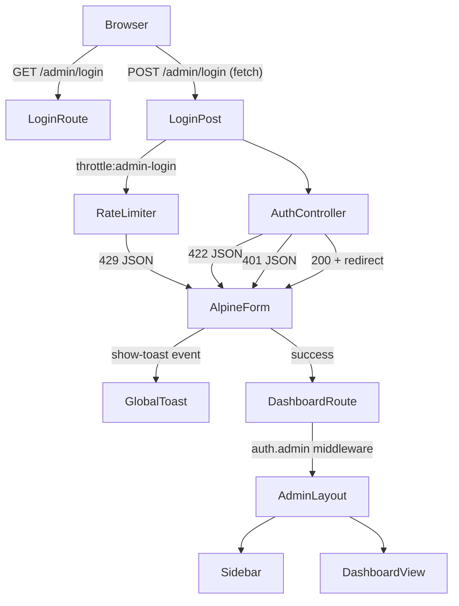

# Admin Auth, Login UI, Dashboard Shell & Global Toast

## What already exists (no changes needed)
- [`config/auth.php`](f:\sharm4you\config\auth.php) — `admin` guard + `admins` provider configured
- [`app/Models/Admin.php`](f:\sharm4you\app\Models\Admin.php) — needs `$fillable` / `$hidden` filled out
- [`app/Http/Middleware/AdminMiddleware.php`](f:\sharm4you\app\Http\Middleware\AdminMiddleware.php) — extends `Authenticate`, defaults to `admin` guard
- [`app/Http/Controllers/Admin/AuthController.php`](f:\sharm4you\app\Http\Controllers\Admin\AuthController.php) — full login/logout + JSON branch (ready for Alpine fetch)
- [`database/migrations/…_create_admins_table.php`](f:\sharm4you\database\migrations\2026_06_23_223801_create_admins_table.php) — `id, name, username, email, photo, password, remember_token`

---

## Architecture



---

## Files to create / modify

### 1. [`app/Models/Admin.php`](f:\sharm4you\app\Models\Admin.php) — flesh out
```php
protected $fillable = ['name', 'username', 'email', 'photo', 'password'];
protected $hidden   = ['password', 'remember_token'];
protected $casts    = ['password' => 'hashed'];
```

### 2. [`routes/admin.php`](f:\sharm4you\routes\admin.php) — create
```php
Route::prefix('admin')->name('admin.')->group(function () {

    // Guest-only routes
    Route::middleware('guest:admin')->group(function () {
        Route::get('/login',  [AuthController::class, 'showLogin'])->name('login');
        Route::post('/login', [AuthController::class, 'login'])
             ->middleware('throttle:admin-login')
             ->name('login.post');
    });

    // Authenticated routes
    Route::middleware('auth.admin')->group(function () {
        Route::get('/', [DashboardController::class, 'index'])->name('dashboard');
        Route::post('/logout', [AuthController::class, 'logout'])->name('logout');
    });
});
```

### 3. [`bootstrap/app.php`](f:\sharm4you\bootstrap\app.php) — two additions
- Add `admin` route file in `withRouting()`
- Register `auth.admin` alias and the rate limiter definition

```php
->withRouting(
    web:     __DIR__.'/../routes/web.php',
    then:    fn () => Route::middleware('web')->group(base_path('routes/admin.php')),
    ...
)
->withMiddleware(function (Middleware $middleware) {
    $middleware->alias([
        'locale'     => \App\Http\Middleware\SetLocale::class,
        'auth.admin' => \App\Http\Middleware\AdminMiddleware::class,
    ]);
})
```

Rate limiter goes in `AppServiceProvider::boot()`:
```php
RateLimiter::for('admin-login', function (Request $request) {
    return Limit::perMinute(5)
        ->by($request->input('username').'|'.$request->ip())
        ->response(fn () => response()->json([
            'success' => false,
            'message' => 'Too many attempts. Try again in 60 seconds.',
        ], 429));
});
```

### 4. `app/Http/Controllers/Admin/DashboardController.php` — new (simple)
```php
public function index() {
    return view('admin.dashboard');
}
```

### 5. `resources/views/components/toast.blade.php` — global toast (no CDN)
- Pure Alpine + CSS — included in **both** `layouts/app.blade.php` (public) and `admin/layouts/app.blade.php`
- Triggered from anywhere with:
  ```js
  window.dispatchEvent(new CustomEvent('show-toast', {
      detail: { type: 'success', message: 'Done!' }
  }))
  ```
- Alpine component: `toasts` array, each item `{ id, type, message, visible }`, auto-dismiss after 4 s, stacked top-right
- Types: `success` | `error` | `warning` | `info` — each gets a distinct left-border accent color derived from the site palette

### 6. `resources/views/admin/auth/login.blade.php` — login page
- Standalone (no sidebar), uses brand + site palette (`sharm-deep` bg with `sharm-sand` card)
- Alpine component on `<form>`:
  - `loading: false`, `errors: {}`, `form: { username, password }`
  - On submit: set `loading = true`, `fetch` POST with CSRF header, handle 200/401/422/429
  - On 200: dispatch `show-toast success`, then `window.location = response.redirect`
  - On 422/401: populate `errors`, dispatch `show-toast error`
  - On 429: show rate-limit message in toast
  - Button: spinner SVG + "Signing in…" text when `loading`, disabled
  - Field-level error messages under each input using `x-text="errors.username?.[0]"`
- Form centered, card with subtle shadow, brand logo at top, design matches site palette

### 7. `resources/views/admin/layouts/app.blade.php` — admin shell
- Sidebar + main content layout, full height
- Alpine state at `<body>`:
  - `sidebarCollapsed` — desktop collapsed/expanded, persisted in `localStorage`
  - `sidebarOpen` — mobile drawer open/close
- Sidebar:
  - Expanded: 240 px with icon + text labels
  - Collapsed: 64 px with icons only + tooltip on hover
  - Toggle button at top of sidebar
  - Mobile: full-width overlay drawer, backdrop click closes
  - Nav items: Dashboard, Gallery (disabled), Packages (disabled), Settings (disabled), Logout
- Top bar: hamburger (mobile), breadcrumb/page title, admin name from `Auth::guard('admin')->user()->name`
- `@yield('content')` for pages
- Includes `<x-toast>`

### 8. `resources/views/admin/dashboard.blade.php` — overview
- `@extends('admin.layouts.app')`
- Static cards: Sessions Today, Total Photos, Packages, Messages (all placeholder numbers)
- "Quick actions" section with links (all placeholder for now)
- Clean, minimal — matches brand palette using `bg-white`, `border-sharm-deep/10`, gold accents

---

## Sidebar responsive behavior

| State | Desktop | Mobile |
|-------|---------|--------|
| Default | Expanded (240px) | Hidden |
| Collapsed | Icon-only (64px) | — |
| `sidebarOpen=true` | — | Overlay drawer + backdrop |

---

## Security checklist
- Rate limit: 5 attempts per minute keyed on `username|IP` → custom 429 JSON response
- Session regeneration on login (already in controller)
- Session invalidation on logout (already in controller)
- CSRF on all POST routes (Laravel default + `X-CSRF-TOKEN` header on Alpine fetch)
- `guest:admin` middleware prevents re-login if already authenticated
- No registration route exposed
