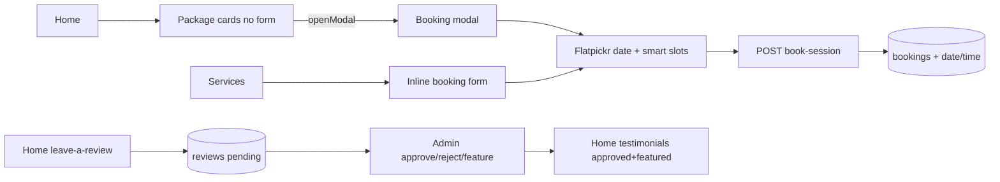

# Booking Date/Time + Reviews Module

## Audit summary (before changes)
- Clean modern Laravel: form requests, scopes, accessors, JSON-driven Alpine admin CRUD. No major issues.
- Dead code: [`StorePackageRequest.php`](F:\sharm4you\app\Http\Requests\Admin\StorePackageRequest.php) and [`UpdatePackageRequest.php`](F:\sharm4you\app\Http\Requests\Admin\UpdatePackageRequest.php) are unused legacy (controller uses the `...TierRequest` variants). Recommend deleting.
- `bookings` has no date/time column; `StoreBookingRequest` locks `package_id` to current-locale currency. Both need extension (expected new work).

## Key decisions (confirmed)
- Time slots: **dynamic**, stored as `available_times` **JSON column on `packages`** (tier-level, written to all 3 currency rows together). No pivot table — over-engineered for a lock-free list.
- Picker: **Flatpickr** for date + custom **time-slot buttons** filtered by smart logic.
- Smart filter: for **today**, hide past slots; future dates show all tier slots.
- No availability lock — multiple customers may book the same slot.
- Reviews: plain DB columns (NOT `__()` keys) so comments stay in original language regardless of site locale.

---

## Part 1 — Package data (reseed, no migrate:fresh)
Edit [`PackageSeeder.php`](F:\sharm4you\database\seeders\PackageSeeder.php):
- Add `available_times` per tier: 2h -> `08,10,12,14,16,18,20`; 4h -> `08,12,16`; 8h -> `08` (24h `HH:MM`).
- Replace `description_*` with the exact provided copy (EN/RU/IT) for each tier.
- Since seeder uses `updateOrCreate` keyed by `(currency, hours)`, run `php artisan db:seed --class=PackageSeeder` to update existing rows.

New migration `add_available_times_to_packages_table`: `->json('available_times')->nullable()->after('hours')`. Cast `available_times => 'array'` on [`Package.php`](F:\sharm4you\app\Models\Package.php); add to `$fillable`.

## Part 2 — Booking date & time
- Migration `add_session_datetime_to_bookings_table`: `session_date` (date, nullable) + `session_time` (string `HH:MM`, nullable) after `package_id`.
- [`Booking.php`](F:\sharm4you\app\Models\Booking.php): add both to `$fillable`, cast `session_date => 'date'`, add a `session_datetime_label` accessor for admin display.
- [`StoreBookingRequest.php`](F:\sharm4you\app\Http\Requests\StoreBookingRequest.php): require `session_date` (date, today or future) + `session_time` (in the selected package's `available_times`, and not a past slot if date == today).
- [`BookSessionController.php`](F:\sharm4you\app\Http\Controllers\BookSessionController.php): persist the two new fields.

## Part 3 — Booking UI (Flatpickr + smart slots)
- [`booking-form-scripts.blade.php`](F:\sharm4you\resources\views\partials\booking-form-scripts.blade.php): load Flatpickr CDN; extend `bookingForm()` with `session_date`, `session_time`, a `packagesSlots` map (`@json`), and an `availableSlots()` computed that returns the selected package's slots minus past slots when date is today. Reset `session_time` on package/date change. Validate both fields.
- [`booking-fields.blade.php`](F:\sharm4you\resources\views\partials\booking-fields.blade.php): add a Flatpickr date input and a slot-button grid (matches the screenshots) bound to `session_time`; both work in inline form and modal.

## Part 4 — Admin bookings + packages slot editor
- [`Admin/BookingController.php`](F:\sharm4you\app\Http\Controllers\Admin\BookingController.php): include date/time in `serializeBooking()`; [`bookings/index.blade.php`](F:\sharm4you\resources\views\admin\bookings\index.blade.php) shows the session date/time.
- Packages tier editor: add `available_times` inputs (comma/list of `HH:MM`) to [`admin/packages/index.blade.php`](F:\sharm4you\resources\views\admin\packages\index.blade.php); validate in `StorePackageTierRequest`/`UpdatePackageTierRequest` (array of `HH:MM`); persist across all 3 currency rows in [`Admin/PackageController.php`](F:\sharm4you\app\Http\Controllers\Admin\PackageController.php).

## Part 5 — Packages on home page + global location line
- Include `partials.packages-section` in [`home.blade.php`](F:\sharm4you\resources\views\home.blade.php) right after the Featured Gallery section; wrap the shared `bookingForm()` Alpine root + include `booking-form-scripts` on home, and pass `$packages` from the home route in [`web.php`](F:\sharm4you\routes\web.php). Home cards show packages WITHOUT the inline book form (modal still opens from card button).
- Add the global location line "Live meeting, Sharm El-Sheikh" and update the packages subtitle to "Choose the perfect photo session by selecting your preferred number of hours." under the Our Packages heading — via `site.packages.*` keys in `lang/en|ru|it/site.php`.

## Part 6 — Reviews module
Data:
- `reviews` table: `name`, `country` (name), `country_code` (ISO for flag), `comment` (original language), `status` enum(`pending`,`approved`,`rejected`) default `pending`, `is_featured` bool, `sort_order`. Model `Review` with scopes `approved()`, `featured()`, `ordered()`.
- `ReviewSeeder`: realistic reviews from Russia, USA, London/UK, Dubai/UAE, Paris/France, Italy, Munich/Germany, Egypt, etc., each in its own language.

Public:
- Home Testimonials section renders up to 12 approved+featured reviews (replacing the static lang array), each with country flag (from `country_code`), name, country, comment — comment shown verbatim, never translated.
- "Leave a review" form in the Testimonials section: name + country dropdown + comment -> stored as `pending`. Route + `StoreReviewRequest` + throttle (reuse booking throttle pattern).

Admin:
- Enable the existing disabled "Testimonials" nav item -> Reviews admin (routes `admin.reviews.*`).
- Alpine JSON CRUD like packages: list all reviews, create new, approve/reject (status), toggle featured (cap 12 like gallery), edit, delete.

## Part 7 — Cleanup
- Delete unused `StorePackageRequest.php` / `UpdatePackageRequest.php`.

## Flow
