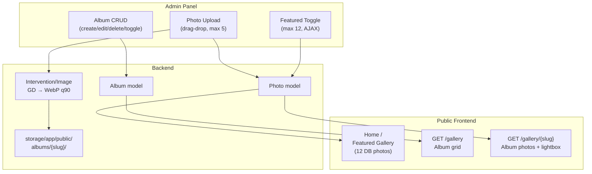

# Gallery CMS — Albums, Photos, Featured Toggle & WebP Upload

## Overview

Replace the static gallery (photos hardcoded in `lang/*/site.php`) with a database-driven system. Admin can create **albums** (multilingual names), upload photos with drag-drop (converted to WebP), and toggle **featured** status (max 12). Public `/gallery` page shows albums first; clicking an album shows its photos with the existing lightbox.

**Static content stays static:** The home page gallery section headings ("Portfolio", "Featured Gallery", subtitle) and the `/gallery` page headings remain in translation files. Only the **photo grid** becomes dynamic.

---

## Architecture



---

## Database Schema

### `albums` table

| Column | Type | Notes |
|--------|------|-------|
| `id` | bigIncrements | PK |
| `name_en` | string(255) | English name |
| `name_ru` | string(255) | Russian name |
| `name_it` | string(255) | Italian name |
| `slug` | string(255) | Unique, URL-safe, auto-generated from `name_en` |
| `is_active` | boolean | Default `true` — inactive albums hidden from frontend |
| `sort_order` | unsignedInteger | Default `0` — lower = first |
| `cover_photo_id` | unsignedBigInt, nullable | FK to `photos.id` (first photo auto-assigned if null) |
| `timestamps` | | created_at, updated_at |

### `photos` table

| Column | Type | Notes |
|--------|------|-------|
| `id` | bigIncrements | PK |
| `album_id` | foreignId | FK → `albums.id`, cascade delete |
| `filename` | string(255) | WebP filename stored on disk |
| `original_name` | string(255) | Original upload filename (for admin reference) |
| `alt_en` | string(500), nullable | Alt text English (defaults to original filename minus ext) |
| `alt_ru` | string(500), nullable | Alt text Russian |
| `alt_it` | string(500), nullable | Alt text Italian |
| `is_featured` | boolean | Default `false` — max 12 globally |
| `sort_order` | unsignedInteger | Default `0` — within album |
| `timestamps` | | created_at, updated_at |

> [!NOTE]
> Migration runs with `php artisan migrate` — no `--fresh`, no wipe.

---

## Storage Layout

```
storage/app/public/albums/
├── moses-mountain/
│   ├── abc123.webp
│   ├── def456.webp
│   └── ...
├── dahab/
│   ├── ghi789.webp
│   └── ...
└── ...
```

- **Disk:** `public` (`storage/app/public/`)
- **Symlink:** `public/storage/` → `storage/app/public/` (via `php artisan storage:link`)
- **URL pattern:** `/storage/albums/{slug}/{filename}.webp`
- **Naming:** UUID-based filenames (e.g. `a3f8c1d2.webp`) to avoid conflicts

---

## WebP Conversion

Using `intervention/image` with GD driver (no Imagick dependency):

```php
use Intervention\Image\ImageManager;
use Intervention\Image\Drivers\Gd\Driver as GdDriver;

$manager = new ImageManager(new GdDriver());
$image = $manager->read($uploadedFile->getRealPath());
$encoded = $image->toWebp(quality: 90);

Storage::disk('public')->put("albums/{$slug}/{$uuid}.webp", (string) $encoded);
```

> [!IMPORTANT]
> Requires `composer require intervention/image:^3.0` — uses the v3 API with GD driver.

---

## Admin Routes (all AJAX, under `auth.admin`)

Added to [admin.php](file:///f:/sharm4you/routes/admin.php) inside the existing `auth.admin` group:

```
GET    /admin/gallery                     → AlbumController@index       (album list page)
POST   /admin/gallery                     → AlbumController@store       (create album)
PUT    /admin/gallery/{album}             → AlbumController@update      (edit album name/active)
DELETE /admin/gallery/{album}             → AlbumController@destroy     (delete album + all photos)
PATCH  /admin/gallery/{album}/toggle      → AlbumController@toggleActive

GET    /admin/gallery/{album}/photos      → PhotoController@index       (album detail page)
POST   /admin/gallery/{album}/photos      → PhotoController@upload      (bulk upload, max 5)
DELETE /admin/gallery/photos/{photo}      → PhotoController@destroy     (delete single photo)
PATCH  /admin/gallery/photos/{photo}/featured → PhotoController@toggleFeatured
PUT    /admin/gallery/photos/{photo}      → PhotoController@update      (edit alt text)
```

---

## Public Routes

Update [web.php](file:///f:/sharm4you/routes/web.php) — replace the static `view('gallery')` route:

```
GET /gallery              → GalleryController@index      (album grid)
GET /gallery/{album:slug} → GalleryController@show       (album photos)
```

Same pattern for `/ru/gallery`, `/it/gallery` etc. (existing locale prefix group).

---

## Proposed Changes

### Composer Dependency

#### Install `intervention/image` v3

```bash
composer require intervention/image:^3.0
```

No config publish needed — we instantiate `ImageManager` directly in the controller.

---

### Database

#### [NEW] Migration: `create_albums_table`

Columns as per schema above. Unique index on `slug`.

#### [NEW] Migration: `create_photos_table`

Columns as per schema above. Foreign key `album_id` → `albums.id` with cascade delete. Index on `is_featured`.

---

### Models

#### [NEW] [Album.php](file:///f:/sharm4you/app/Models/Album.php)

- `$fillable`: `name_en`, `name_ru`, `name_it`, `slug`, `is_active`, `sort_order`, `cover_photo_id`
- `$casts`: `is_active` → `boolean`
- Relationships: `photos()` hasMany, `coverPhoto()` belongsTo Photo
- Accessor: `name` — returns localized name based on `app()->getLocale()`
- Scope: `scopeActive($query)` — `where('is_active', true)`
- Auto-generate `slug` from `name_en` on creating event (using `Str::slug`)

#### [NEW] [Photo.php](file:///f:/sharm4you/app/Models/Photo.php)

- `$fillable`: `album_id`, `filename`, `original_name`, `alt_en`, `alt_ru`, `alt_it`, `is_featured`, `sort_order`
- `$casts`: `is_featured` → `boolean`
- Relationships: `album()` belongsTo Album
- Accessor: `alt` — returns localized alt text based on `app()->getLocale()`, falls back to `alt_en`
- Accessor: `url` — returns full public URL (`/storage/albums/{album-slug}/{filename}`)
- Scope: `scopeFeatured($query)` — `where('is_featured', true)`

---

### Form Requests

#### [NEW] `StoreAlbumRequest`

```php
'name_en' => ['required', 'string', 'max:255'],
'name_ru' => ['required', 'string', 'max:255'],
'name_it' => ['required', 'string', 'max:255'],
```

Validates uniqueness of generated slug.

#### [NEW] `UpdateAlbumRequest`

Same as store but ignores current album for slug uniqueness.

#### [NEW] `UploadPhotosRequest`

```php
'photos'   => ['required', 'array', 'min:1', 'max:5'],
'photos.*' => ['required', 'file', 'mimes:jpeg,png,webp', 'max:3072'], // 3MB
```

Backend validates MIME via `finfo` (not just extension) for security.

---

### Controllers

#### [NEW] `Admin\AlbumController`

| Method | Logic |
|--------|-------|
| `index()` | Return `admin.gallery.index` view with all albums (sorted, with photo counts) |
| `store(StoreAlbumRequest)` | Create album, generate slug, return JSON `{ success, album }` |
| `update(UpdateAlbumRequest, Album)` | Update names/slug, return JSON |
| `destroy(Album)` | Delete album folder from storage + delete DB records, return JSON |
| `toggleActive(Album)` | Toggle `is_active`, return JSON `{ success, is_active }` |

#### [NEW] `Admin\PhotoController`

| Method | Logic |
|--------|-------|
| `index(Album)` | Return `admin.gallery.show` view with album + photos |
| `upload(UploadPhotosRequest, Album)` | Loop files → Intervention WebP q90 → store → create Photo rows. Return JSON `{ success, photos[] }` |
| `destroy(Photo)` | Delete file from disk + DB row. If was cover, reset album cover. Return JSON |
| `toggleFeatured(Photo)` | Check global featured count. If turning ON and count ≥ 12 → return 422 with warning message. Else toggle + return JSON `{ success, is_featured, featured_count }` |
| `update(Photo)` | Update alt texts (en/ru/it), return JSON |

#### [NEW] `GalleryController` (public)

| Method | Logic |
|--------|-------|
| `index()` | Query active albums with photo count, pass to `gallery.blade.php` |
| `show(Album $album)` | Abort 404 if inactive. Load photos ordered by `sort_order`. Pass to `gallery-album.blade.php` |

---

### Admin Views

#### [NEW] `admin/gallery/index.blade.php` — Album List

- Extends `admin.layouts.app`
- Header: "Gallery" title + "Create Album" button
- Album grid/list: each album card shows:
  - Cover thumbnail (first photo or placeholder)
  - Localized name (EN primary, RU/IT shown smaller)
  - Photo count badge
  - Active/Inactive toggle (AJAX `PATCH`)
  - Edit button → opens edit modal
  - Delete button → confirmation dialog → AJAX `DELETE`
- **Create Modal** (Alpine `x-show`, simple — no heavy animation):
  - 3 text inputs: Name EN, Name RU, Name IT
  - Submit via `fetch` POST → on success: toast + prepend album to list
- **Edit Modal**: Same fields, pre-filled, PUT request

#### [NEW] `admin/gallery/show.blade.php` — Album Photos

- Extends `admin.layouts.app`
- Breadcrumb: Gallery → {Album Name}
- **Upload Zone** at top:
  - Drag & drop area (dashed border, icon, "Drop images here or click to browse")
  - Alpine component handles:
    - File type validation: only `.png`, `.jpeg`, `.jpg`, `.webp`
    - File size validation: max 3MB per file
    - Max 5 files per batch (shows error toast if more)
    - Progress indicators per file (uploading/done/error)
    - Uses `FormData` + `fetch` POST with CSRF
    - On success: toast + append new photos to grid
- **Photo Grid** below upload zone:
  - Thumbnail cards with:
    - Image preview
    - ⭐ Featured toggle (gold star icon when active)
    - Delete button (trash icon → confirm → AJAX DELETE)
    - Edit alt text button → small modal with EN/RU/IT inputs
  - Featured badge shows current count: "3 / 12 featured"
  - When toggling featured ON and already 12: warning toast "Maximum 12 featured photos reached. Unfeature another photo first."

---

### Public Views

#### [MODIFY] [home.blade.php](file:///f:/sharm4you/resources/views/home.blade.php)

**Featured Gallery section (lines 94–126):** Replace the `@foreach (__('site.gallery.featured_photos'))` loop with a `@foreach ($featuredPhotos)` loop that uses DB photos. The section headings, labels, and subtitle remain static from translation files.

The bento grid span pattern uses a predefined array matching the current 12-photo layout:

```php
$spanPattern = [
    'md:col-span-2 md:row-span-2', '', '', 'md:row-span-2',
    '', '', 'md:col-span-2', '', '', 'md:row-span-2', '', '',
];
```

The `$featuredPhotos` variable is passed from a view composer or a simple closure route.

#### [MODIFY] [gallery.blade.php](file:///f:/sharm4you/resources/views/gallery.blade.php)

Refactor to show **album grid** instead of all photos:
- Keep static headings from translation files
- Display active albums as cards (cover image, localized name, photo count)
- Each card links to `/gallery/{slug}` (or `/{locale}/gallery/{slug}`)
- Remove the old all-photos masonry + lightbox code from this view

#### [NEW] [gallery-album.blade.php](file:///f:/sharm4you/resources/views/gallery-album.blade.php)

Shows a single album's photos:
- "← Back to Gallery" link (like existing "← Back to Home")
- Album name as `<h1>` (localized)
- Masonry photo grid (reuse existing CSS columns layout)
- Lightbox (reuse the existing Alpine lightbox code from current `gallery.blade.php`)
- "Book a Session" CTA at bottom

---

### Route Changes

#### [MODIFY] [web.php](file:///f:/sharm4you/routes/web.php)

Replace:
```php
Route::get('/gallery', fn () => view('gallery'))->name('gallery');
```
With:
```php
Route::get('/gallery', [GalleryController::class, 'index'])->name('gallery');
Route::get('/gallery/{album:slug}', [GalleryController::class, 'show'])->name('gallery.album');
```

Same for the `{locale}` prefix group.

#### [MODIFY] [admin.php](file:///f:/sharm4you/routes/admin.php)

Add gallery routes inside the `auth.admin` group (as listed above).

---

### Admin Sidebar Update

#### [MODIFY] [admin/layouts/app.blade.php](file:///f:/sharm4you/resources/views/admin/layouts/app.blade.php)

Change the Gallery nav item from `disabled: true` to active with `route => 'admin.gallery.index'`.

---

### Dashboard Update

#### [MODIFY] [admin/dashboard.blade.php](file:///f:/sharm4you/resources/views/admin/dashboard.blade.php)

- Update "Gallery Photos" stat card to show real count from `Photo::count()`
- Update "Add Photo to Gallery" quick action to link to gallery index

---

### Translation File Cleanup

#### [MODIFY] `lang/en/site.php` (and `ru`, `it`)

- Remove `gallery.featured_photos` array (moved to DB)
- Remove `gallery.all_photos` array (moved to DB)
- Keep all other gallery strings (labels, titles, subtitles)
- Add new keys: `gallery.albums_subtitle`, `gallery.no_albums`, `gallery.photos_count`

#### [MODIFY] `lang/en/seo.php` (and `ru`, `it`)

- Add `gallery_album` SEO key for individual album pages

---

### Home Route — Pass Featured Photos

#### [MODIFY] [web.php](file:///f:/sharm4you/routes/web.php)

Change home route from `fn () => view('home')` to use `GalleryController` or a simple closure that queries featured photos:

```php
Route::get('/', function () {
    $featuredPhotos = \App\Models\Photo::with('album')
        ->featured()
        ->orderBy('sort_order')
        ->limit(12)
        ->get();
    return view('home', compact('featuredPhotos'));
})->name('home');
```

---

## Open Questions

> [!IMPORTANT]
> **Album cover image:** Should the album card on the public gallery page show the **first photo** of the album as the cover, or do you want a separate "set as cover" option in admin? I'm planning to auto-use the first photo (by sort_order) as the cover, which keeps things simpler.

> [!IMPORTANT]
> **Photo alt text in admin:** When uploading photos, should the admin fill in alt text (EN/RU/IT) during upload, or is it fine to auto-generate from filename and let admin edit later via an edit button? I'm planning the **edit-later** approach since bulk upload with 5 photos + 3 alt fields each = 15 inputs would be overwhelming.

> [!IMPORTANT]
> **Photo reordering:** Do you want drag-to-reorder photos within an album in admin, or is manual sort_order sufficient for now? Drag-sort requires an additional JS library. I'm planning **no drag-sort for now** — newest photos appear first, admin can adjust sort_order later if needed.

---

## Verification Plan

### Automated

```bash
php artisan migrate                    # Run new migrations
php artisan storage:link               # Create symlink
php artisan route:list --path=gallery  # Verify all routes registered
```

### Manual Verification

1. **Admin — Albums:** Create album with EN/RU/IT names → appears in list → edit → toggle active/inactive → delete (with photos)
2. **Admin — Upload:** Drag 5 valid images → all convert to WebP → appear in grid → try 6 → error. Try a `.txt` file → rejected. Try 4MB image → rejected
3. **Admin — Featured:** Toggle featured on 12 photos → all show ⭐ → try 13th → warning toast. Unfeature one → can feature another
4. **Public — Home:** Featured section shows up to 12 DB photos in bento layout
5. **Public — Gallery:** `/gallery` shows active albums → click album → see photos with lightbox → keyboard nav works
6. **Locales:** Test `/ru/gallery`, `/it/gallery` — album names in correct language, alt text localized
7. **Storage:** Check `storage/app/public/albums/{slug}/` has WebP files, accessible via `/storage/albums/...`

---

## Files Summary

| Action | File |
|--------|------|
| Install | `composer require intervention/image:^3.0` |
| Run | `php artisan migrate` |
| Run | `php artisan storage:link` |
| NEW | `database/migrations/..._create_albums_table.php` |
| NEW | `database/migrations/..._create_photos_table.php` |
| NEW | `app/Models/Album.php` |
| NEW | `app/Models/Photo.php` |
| NEW | `app/Http/Controllers/Admin/AlbumController.php` |
| NEW | `app/Http/Controllers/Admin/PhotoController.php` |
| NEW | `app/Http/Controllers/GalleryController.php` |
| NEW | `app/Http/Requests/Admin/StoreAlbumRequest.php` |
| NEW | `app/Http/Requests/Admin/UpdateAlbumRequest.php` |
| NEW | `app/Http/Requests/Admin/UploadPhotosRequest.php` |
| NEW | `resources/views/admin/gallery/index.blade.php` |
| NEW | `resources/views/admin/gallery/show.blade.php` |
| NEW | `resources/views/gallery-album.blade.php` |
| MODIFY | `routes/admin.php` |
| MODIFY | `routes/web.php` |
| MODIFY | `resources/views/admin/layouts/app.blade.php` (sidebar) |
| MODIFY | `resources/views/admin/dashboard.blade.php` (stats) |
| MODIFY | `resources/views/home.blade.php` (featured from DB) |
| MODIFY | `resources/views/gallery.blade.php` (albums grid) |
| MODIFY | `lang/en/site.php` (remove static photos, add album keys) |
| MODIFY | `lang/ru/site.php` (same) |
| MODIFY | `lang/it/site.php` (same) |
| MODIFY | `lang/en/seo.php` (add gallery_album SEO) |
| MODIFY | `lang/ru/seo.php` (same) |
| MODIFY | `lang/it/seo.php` (same) |
