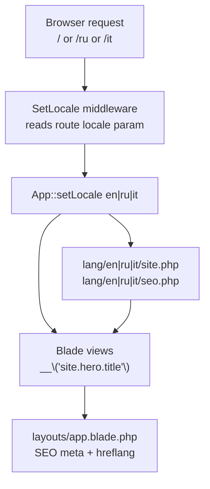

# Sharm4You — Multilingual + SEO Plan

## My opinion — you are on the right track

**Yes, URL prefixes are the right call for SEO.** They beat query strings (`?lang=ru`, like Cuscino uses) because:

- Each language gets a **unique, crawlable URL** (`/`, `/ru`, `/it`)
- **`hreflang`** tags map cleanly to those URLs
- Users can **bookmark and share** the Russian version directly
- Google treats language versions as separate pages, not one page with a session flag

**Splitting static SEO now vs backend later is also correct.** For a photography site, the admin panel will eventually own:

- Gallery image alt text per photo
- Dynamic page titles/descriptions per upload
- XML sitemap from CMS pages
- JSON-LD `ImageGallery` / `LocalBusiness` with real phone, address, geo

Doing that now without a database would be fake data. Your approach — **solid foundation in layout + static home translations** — is exactly what Laravel projects do at this stage.

**One note:** keep all locales **LTR** as you said. Russian in LTR is fine for a tourist-facing site; no `dir="rtl"` needed.

---

## Architecture overview



**URL map (English at root — your choice):**

| Language | Home URL | Example future page |
|----------|----------|---------------------|
| English  | `/`      | `/services`         |
| Russian  | `/ru`    | `/ru/services`      |
| Italian  | `/it`    | `/it/services`      |

---

## Phase 1 — Locale configuration

### 1. Create [`config/locales.php`](config/locales.php)

Central list of supported locales (single source of truth):

```php
return [
    'default' => 'en',
    'supported' => [
        'en' => ['name' => 'English', 'native' => 'English', 'hreflang' => 'en'],
        'ru' => ['name' => 'Russian', 'native' => 'Русский', 'hreflang' => 'ru'],
        'it' => ['name' => 'Italian', 'native' => 'Italiano', 'hreflang' => 'it'],
    ],
];
```

### 2. Create [`app/Http/Middleware/SetLocale.php`](app/Http/Middleware/SetLocale.php)

- Read `{locale}` from route (nullable)
- If missing or invalid → default `en`
- `App::setLocale($locale)`
- Share `$currentLocale` with all views via `View::share()` or view composer

### 3. Register middleware in [`bootstrap/app.php`](bootstrap/app.php)

```php
->withMiddleware(function (Middleware $middleware): void {
    $middleware->alias(['locale' => \App\Http\Middleware\SetLocale::class]);
})
```

### 4. Create [`app/Helpers/LocaleHelper.php`](app/Helpers/LocaleHelper.php) (or trait on a service)

Helper functions used in Blade:

- `current_locale()` → `'en'`, `'ru'`, `'it'`
- `localized_url($locale, $path = '/')` → builds `/ru`, `/it`, or `/`
- `alternate_urls()` → array for hreflang loop

Autoload via `composer.json` `"files"` or a simple `AppServiceProvider` boot.

---

## Phase 2 — Routing with locale prefix

Update [`routes/web.php`](routes/web.php):

```php
Route::group([
    'prefix' => '{locale?}',
    'where' => ['locale' => 'ru|it'],
    'middleware' => 'locale',
], function () {
    Route::get('/', fn () => view('home'))->name('home');
});
```

- **`/`** → English (no prefix in URL)
- **`/ru`** → Russian
- **`/it`** → Italian

Optional safety redirects (recommended):

- `/en` → `/` (301)
- `/en/{any}` → `/{any}` (301) — prevents duplicate English URLs

Named routes: `route('home')` for EN, `route('home', ['locale' => 'ru'])` for RU.

---

## Phase 3 — Translation files (static content)

Laravel 12 uses [`lang/`](lang/) at project root (not `resources/lang`).

### File structure

```
lang/
  en/
    site.php      # UI strings (nav, hero, services, footer...)
    seo.php       # title, description, keywords per page key
  ru/
    site.php
    seo.php
  it/
    site.php
    seo.php
```

### Example [`lang/en/seo.php`](lang/en/seo.php)

```php
return [
    'home' => [
        'title' => 'Sharm4You — Vacation Photographer in Sharm El Sheikh',
        'description' => 'Professional photography in Sharm El Sheikh, Dahab, and South Sinai...',
        'keywords' => 'Vacation photographer in Sharm El Sheikh, Dahab photoshoot locations, South Sinai professional photography, Sea & Desert portrait photography Egypt',
    ],
];
```

Russian and Italian files get **human translations** of the same keys (not machine-translated placeholders in production — use proper copy for RU/IT tourist audience).

### Replace hardcoded strings in views

| File | Change |
|------|--------|
| [`resources/views/home.blade.php`](resources/views/home.blade.php) | All text → `__('site.hero.title')`, services array from lang files |
| [`resources/views/partials/header.blade.php`](resources/views/partials/header.blade.php) | Nav labels translated |
| [`resources/views/partials/footer.blade.php`](resources/views/partials/footer.blade.php) | Footer copy translated |
| [`resources/views/partials/top-bar.blade.php`](resources/views/partials/top-bar.blade.php) | Location line + language dropdown |

Gallery `@foreach` services/photos: move titles, alts, descriptions into `lang/{locale}/site.php` arrays.

---

## Phase 4 — Language dropdown in top bar

Update [`resources/views/partials/top-bar.blade.php`](resources/views/partials/top-bar.blade.php):

- Alpine.js small dropdown (no icon library — text labels: `EN | RU | IT` or native names)
- Each option links to `localized_url('ru')`, `localized_url('it')`, `localized_url('en')`
- Highlight active locale
- **Link-based switching** (not session-only) — best for SEO and shared hosting

When more pages exist, helper accepts current path so `/ru` on services page becomes `/ru/services`.

---

## Phase 5 — SEO in layout (static — implement now)

### Dynamic SEO section in [`resources/views/layouts/app.blade.php`](resources/views/layouts/app.blade.php)

Replace hardcoded meta with a structured system:

```blade
@php
    $seoKey = $seoKey ?? 'home';
    $seo = trans("seo.{$seoKey}");
@endphp

<html lang="{{ str_replace('_', '-', app()->getLocale()) }}">

<title>@yield('title', $seo['title'] ?? config('app.name'))</title>
<meta name="description" content="@yield('meta_description', $seo['description'] ?? '')">
<meta name="keywords" content="@yield('meta_keywords', $seo['keywords'] ?? '')">
<link rel="canonical" href="@yield('canonical', url()->current())">

{{-- hreflang alternates --}}
@foreach (alternate_urls() as $locale => $url)
    <link rel="alternate" hreflang="{{ config("locales.supported.{$locale}.hreflang") }}" href="{{ $url }}">
@endforeach
<link rel="alternate" hreflang="x-default" href="{{ localized_url('en') }}">

{{-- Open Graph --}}
<meta property="og:locale" content="{{ og_locale() }}">
<meta property="og:title" content="@yield('title', $seo['title'])">
<meta property="og:description" content="@yield('meta_description', $seo['description'])">
<meta property="og:url" content="{{ url()->current() }}">
<meta property="og:type" content="@yield('og_type', 'website')">
@hasSection('og_image')
    <meta property="og:image" content="@yield('og_image')">
@endif

{{-- Twitter Card (minimal) --}}
<meta name="twitter:card" content="summary_large_image">
<meta name="twitter:title" content="@yield('title', $seo['title'])">
<meta name="twitter:description" content="@yield('meta_description', $seo['description'])">

@yield('json_ld')
```

### Implement SEO in views

[`resources/views/home.blade.php`](resources/views/home.blade.php):

```blade
@extends('layouts.app')

@php $seoKey = 'home'; @endphp

{{-- Optional overrides --}}
@section('title', __('seo.home.title'))
@section('meta_description', __('seo.home.description'))
```

### Static JSON-LD for home (LocalBusiness + WebSite)

Add `@section('json_ld')` in home with localized `name`, `description`, `areaServed` (Sharm El Sheikh, Dahab, South Sinai), `url` — static phone/email for now.

### SEO keywords (your list — in `lang/en/seo.php`)

Include naturally in `keywords` meta and weave into `description` / H1 where readable:

- Vacation photographer in Sharm El Sheikh
- Dahab photoshoot locations
- South Sinai professional photography
- Sea & Desert portrait photography Egypt

**Note:** Google largely ignores `meta keywords`, but it does not hurt. The real SEO value is in **title, description, H1, alt tags, and hreflang** — which this plan covers.

---

## Phase 6 — Local SEO pillars (static scope now)

### A. Semantic URL slugs — partial now, full later

| Now | Later (admin/backend) |
|-----|----------------------|
| `/`, `/ru`, `/it` | `/services`, `/ru/uslugi`, `/gallery/{slug}` |
| Anchor IDs stay English (`#gallery`) — fine for single page | Translated slugs per locale in DB |

For v1 single-page site, locale prefix is enough. When adding pages, define slug map per locale in lang files or DB.

### B. Image alt tags — static now

Move all gallery/hero `alt` strings into translation files:

```php
// lang/en/site.php
'gallery' => [
    ['src' => '...', 'alt' => 'Scuba diver in clear Red Sea water'],
],
```

RU/IT get translated alts — **critical for image search SEO**.

### C. Structured data — static LocalBusiness now

JSON-LD in home view; defer `ImageGallery` schema until gallery is DB-driven.

---

## Deferred — NOT implemented now (wait for admin/backend)

Document these as future tasks:

| Feature | Why wait |
|---------|----------|
| Per-photo alt/title/caption from admin | Needs media model + translations table |
| Dynamic `og:image` per gallery item | Needs uploaded images + CDN paths |
| XML sitemap (`/sitemap.xml`) | Needs all public routes/pages from CMS |
| Translated URL slugs per page | Needs slug column per locale in DB |
| `ImageGallery` / `Photograph` JSON-LD | Needs real portfolio data |
| Blog/service landing pages SEO | Needs CMS content |
| Google Business Profile sync | External + manual |
| hreflang for dynamic gallery URLs | Needs consistent slug mapping across locales |

When admin is built, extend layout SEO to accept `$seo` array from controller:

```php
return view('gallery.show', [
    'seo' => $photo->seoForLocale(app()->getLocale()),
]);
```

---

## Files to create / modify

| Action | File |
|--------|------|
| Create | `config/locales.php` |
| Create | `app/Http/Middleware/SetLocale.php` |
| Create | `app/Helpers/locale.php` (helpers) |
| Update | `bootstrap/app.php` |
| Update | `composer.json` (autoload helpers) |
| Update | `routes/web.php` |
| Create | `lang/en/site.php`, `lang/en/seo.php` |
| Create | `lang/ru/site.php`, `lang/ru/seo.php` |
| Create | `lang/it/site.php`, `lang/it/seo.php` |
| Update | `resources/views/layouts/app.blade.php` |
| Update | `resources/views/partials/top-bar.blade.php` |
| Update | `resources/views/partials/header.blade.php` |
| Update | `resources/views/partials/footer.blade.php` |
| Update | `resources/views/home.blade.php` |

No CSS rebuild required unless dropdown needs minor Tailwind classes (small addition to top bar).

---

## Verification checklist

- `/` shows English, `<html lang="en">`
- `/ru` shows Russian throughout (nav, hero, footer)
- `/it` shows Italian throughout
- Language dropdown switches without losing page context
- View source: `hreflang` links for `en`, `ru`, `it`, `x-default`
- Canonical URL matches current locale URL
- All images have localized `alt` attributes
- `/en` redirects to `/` (no duplicate English)
