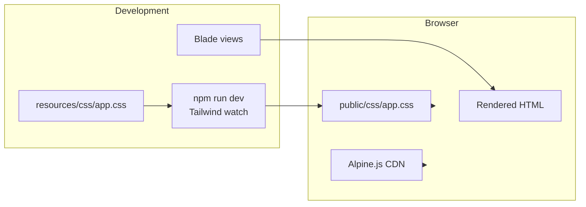

# Sharm4You — Laravel 12 Stack & Static Home Page Plan

## Honest stack opinion

**Your approach is good — and it is a legitimate practice for this kind of project.** It is not the Laravel 12 default (Vite + Tailwind v4), but for a simple photography/marketing site it is a **pragmatic, production-ready choice** you already know well.

| Aspect | Verdict |
|--------|---------|
| Laravel 12 + Blade | Excellent server foundation |
| Alpine.js via CDN | Great fit — lightweight, SPA-like UX without React/Vue |
| Tailwind CLI (not Vite) | Valid for Blade-only apps; custom theme in `tailwind.config.js` |
| Tailwind Play CDN | **Not recommended here** — it cannot use your custom palette/plugins |

**Important clarification on "Tailwind CDN":** Tailwind's Play CDN and Tailwind CLI with custom variables do not work together. The correct setup (same as [Cuscino](F:\Cuscino)) is:

- **Alpine.js** → CDN (`jsdelivr`, pinned version)
- **Tailwind** → CLI build to [`public/css/app.css`](public/css/app.css), linked in layout (not Play CDN)

This gives you custom colors, typography, forms plugin, and a minified production CSS file — which is what you actually need.

**When this stack shines:** marketing sites, portfolios, small business apps, admin-light frontends, bilingual sites later (your Cuscino pattern already proves this).

**When to reconsider Vite later:** if you add heavy custom JS modules, npm-based Alpine plugins beyond CDN, or a component library that needs bundling.

**SPA feel without React:** Alpine handles mobile nav, sticky header, scroll reveals, lightbox/gallery toggles, and smooth transitions (`x-show`, `x-transition`, `@alpinejs/intersect`). Full client-side routing is not needed for v1; the *feel* comes from instant UI interactions + smooth scroll + minimal page weight.



---

## Color palette — Pastel Sinai / Sharm El Sheikh (current)

Shifted from bright Red Sea teal to a softer **sand + slate + gold** palette (inspired by the hero Lottie “pastel summer breeze” look). Defined in [`tailwind.config.js`](tailwind.config.js) as `sharm.*` tokens:

| Token | Hex | Usage |
|-------|-----|-------|
| `sand` | `#F7F3ED` | Default page background — warm off-white |
| `sand-soft` | `#F5F0E8` | Softer section alternates (e.g. FAQs) |
| `sand-dark` | `#EDE6DA` | Section alternates (gallery band, etc.) |
| `sea` | `#3D4F5F` | Primary brand — muted slate blue-gray (buttons, nav hover, top bar) |
| `sea-dark` | `#2F3E4C` | Hover states on primary buttons |
| `reef` | `#C9A96E` | Warm gold accent (labels, highlights) — same value as `desert` |
| `desert` | `#C9A96E` | Gold sand accent — prices, hero label, featured badges |
| `sunset` | `#D4845F` | Sparingly — warm highlights |
| `deep` | `#1C2833` | Headings, dark text, overlays, top bar bg |
| `mist` | `#6B7B8C` | Body / muted text |

**Extra theme token:** `boxShadow.soft` → `0 4px 24px rgba(28, 40, 51, 0.08)`

**Typography (Google Fonts):**
- Headings: **Cormorant Garamond** (`font-display`)
- Body: **Inter** (`font-sans`)

No icon library — inline SVG partials for “Why Us” cards; photography + Lottie as visual interest.

---

## Phase 1 — Remove Vite, set up Tailwind CLI

### 1. Replace [`package.json`](package.json)

Match your Cuscino pattern:

```json
{
  "$schema": "https://json.schemastore.org/package.json",
  "private": true,
  "type": "module",
  "scripts": {
    "dev": "npx tailwindcss -i ./resources/css/app.css -o ./public/css/app.css --watch",
    "build": "npx tailwindcss -i ./resources/css/app.css -o ./public/css/app.css --minify"
  },
  "devDependencies": {
    "@tailwindcss/aspect-ratio": "^0.4.2",
    "@tailwindcss/forms": "^0.5.11",
    "@tailwindcss/typography": "^0.5.19",
    "tailwindcss": "^3.4.19"
  }
}
```

### 2. Create [`tailwind.config.js`](tailwind.config.js)

- `content`: `./resources/**/*.blade.php`, `./resources/**/*.js`
- `theme.extend.colors`: palette above as `sharm.*` namespace (e.g. `bg-sharm-sea`, `text-sharm-deep`)
- `theme.extend.fontFamily`: `sans: ['Inter']`, `display: ['Cormorant Garamond']`
- Plugins: forms, typography, aspect-ratio
- Keep config lean — no Cuscino-level complexity yet

### 3. Rewrite [`resources/css/app.css`](resources/css/app.css)

Replace Tailwind v4 `@import` syntax with v3 directives:

```css
@tailwind base;
@tailwind components;
@tailwind utilities;

[x-cloak] { display: none !important; }

html { scroll-behavior: smooth; }
```

Optional small `@layer components` for reusable `.btn-primary`, `.section-padding`.

### 4. Remove Vite artifacts

- Delete [`vite.config.js`](vite.config.js)
- Remove or leave unused: [`resources/js/app.js`](resources/js/app.js), [`resources/js/bootstrap.js`](resources/js/bootstrap.js) (not loaded in layout)
- Update [`composer.json`](composer.json) `dev` script: rename `--names=...,vite` to `...,css` (still runs `npm run dev` for Tailwind watch)

### 5. Bootstrap CSS output

- Create [`public/css/`](public/css/) directory
- Run `npm install` then `npm run build` to generate initial `app.css`

---

## Phase 2 — Base layout with Alpine CDN

### Create [`resources/views/layouts/app.blade.php`](resources/views/layouts/app.blade.php)

Structure (following [Cuscino layout pattern](F:\Cuscino\resources\views\layout\app.blade.php)):

```html
<!-- Alpine plugins BEFORE core (intersect + collapse for mobile menu) -->
<script defer src="https://cdn.jsdelivr.net/npm/@alpinejs/intersect@3.14.8/dist/cdn.min.js"></script>
<script defer src="https://cdn.jsdelivr.net/npm/@alpinejs/collapse@3.14.8/dist/cdn.min.js"></script>
<script defer src="https://cdn.jsdelivr.net/npm/alpinejs@3.14.8/dist/cdn.min.js"></script>

<link rel="stylesheet" href="{{ asset('css/app.css') }}?v={{ filemtime(public_path('css/app.css')) }}">
```

- Google Fonts: Inter + Cormorant Garamond
- `lang="en"` for now (RTL/bilingual hooks can be added later like Cuscino)
- `@yield('content')` + optional `@yield('title')`
- Root `x-data` for global UI: mobile menu open state, sticky header class

### Create partials

| File | Purpose |
|------|---------|
| [`resources/views/partials/top-bar.blade.php`](resources/views/partials/top-bar.blade.php) | Thin bar: location "Sharm El Sheikh, Egypt", phone/email text links |
| [`resources/views/partials/header.blade.php`](resources/views/partials/header.blade.php) | Logo "Sharm4You", nav links, mobile hamburger (Alpine toggle) |
| [`resources/views/partials/footer.blade.php`](resources/views/partials/footer.blade.php) | Brand, nav repeat, copyright, minimal text-only social links |

**Header behavior (Alpine SPA feel):**
- Sticky on scroll with subtle shadow transition
- Mobile menu slide-down with `x-collapse`
- Active nav highlight on current section (anchor links)

---

## Phase 3 — Static home page

### Update [`routes/web.php`](routes/web.php)

```php
Route::get('/', fn () => view('home'));
```

### Delete [`resources/views/welcome.blade.php`](resources/views/welcome.blade.php)

### Create [`resources/views/home.blade.php`](resources/views/home.blade.php)

Page sections (top to bottom):

1. **Top bar** — `@include('partials.top-bar')`
2. **Header** — `@include('partials.header')`
3. **Hero** — Full-viewport Unsplash Red Sea / Sinai landscape; headline e.g. *"Capturing Sinai & the Red Sea"*; subtext about photography services; two CTAs: "View Gallery" + "Book a Session"
4. **Services** — 3–4 minimal cards (no icons): Wedding & Events, Travel & Tourism, Drone & Aerial, Portrait & Lifestyle — short copy, `aspect-[4/3]` placeholder or subtle bg
5. **Featured Gallery** — 6-image masonry-style grid using Unsplash URLs (Red Sea diving, desert, Sharm coastline, coral, mountains, golden hour) — hover zoom via Tailwind `group-hover:scale-105`
6. **About / Why Sharm4You** — Split layout: one strong photo + 2–3 short paragraphs (local expertise, natural light, Sinai locations)
7. **CTA band** — Full-width `bg-sharm-sea` section: "Ready to capture your moment?" + contact button
8. **Footer** — `@include('partials.footer')`

**Unsplash images:** use direct `images.unsplash.com` URLs with specific photo IDs (Red Sea, Sinai desert, Egypt coast themes). No local downloads needed for v1.

**Scroll animations:** `@alpinejs/intersect` on sections — fade-up on enter viewport (subtle, not flashy).

### Update [`.env.example`](.env.example) / `.env`

- `APP_NAME=Sharm4You`

---

## Phase 4 — Verify & handoff

**Dev workflow:**
```bash
npm install
npm run dev          # Tailwind watch
php artisan serve    # Laravel server (separate terminal)
```

**Production build:**
```bash
npm run build
```

**Checklist:**
- Home loads at `/` with no Vite references
- Mobile menu works
- Sticky header transitions
- Custom palette visible (slate `sea`, sand backgrounds, gold `desert` accents)
- No welcome page remnants

---

## Future-ready notes (for your next steps)

- **Bilingual:** add `lang` toggle + `dir="rtl"` + Cairo font (copy pattern from Cuscino) — layout already structured for this
- **Gallery lightbox:** Alpine `x-show` modal on gallery click
- **Contact form:** Laravel route + Alpine fetch (no page reload) for SPA feel
- **Livewire:** optional later if you want server-driven components without API layer

---

## Files changed summary

| Action | File |
|--------|------|
| Replace | [`package.json`](package.json) |
| Create | [`tailwind.config.js`](tailwind.config.js) |
| Rewrite | [`resources/css/app.css`](resources/css/app.css) |
| Delete | [`vite.config.js`](vite.config.js), [`resources/views/welcome.blade.php`](resources/views/welcome.blade.php) |
| Create | `layouts/app.blade.php`, `partials/top-bar`, `header`, `footer`, `home.blade.php` |
| Update | [`routes/web.php`](routes/web.php), [`composer.json`](composer.json) dev script label |
| Create | [`public/css/app.css`](public/css/app.css) (via build)
