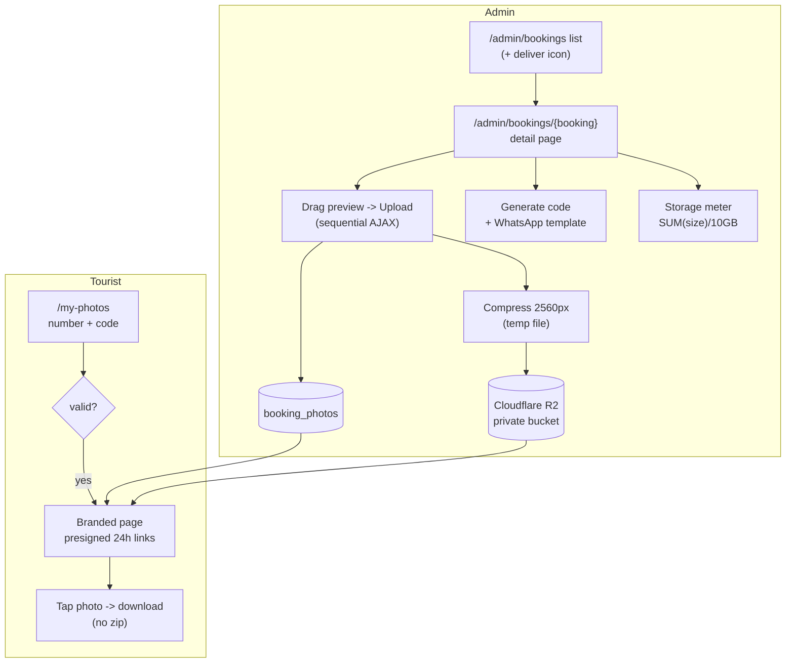

# Tourist Photo Delivery via Cloudflare R2

## Goal & constraints (agreed)
- No tourist login. Session-less, code-based access (like an e-commerce order lookup).
- Delivery photos live on **Cloudflare R2** (S3-compatible, storage `$0.015/GB`, **free egress**, 10 GB free tier). Website gallery is untouched (stays as-is).
- **Nothing** stays on the 15 GB shared host: each upload is compressed, streamed to R2, temp deleted in the same request. **No cron jobs anywhere.**
- Admin ease: drag-drop uploader inside a new booking detail page. Tourist ease: individual per-photo downloads on mobile, **no zip**.

## Key decisions (locked)
- Booking number: `SH-XXXXXX` random alphanumeric (non-guessable, collision-retry on insert).
- Access: private R2 bucket + **on-demand presigned URLs (24h window)**; the `delivery_code` itself never expires. No cron — links regenerate on every page load.
- Compression: Intervention/Image (GD), **keep original format**, quality ~85, scale longest side to **2560px** (proportional, never cropped). ~10MB -> ~1MB.
- Upload UX: drag to **preview** (max 10 per drop, 30 total), then one **Upload** button -> browser sends photos **one-by-one via AJAX** with a `n/total` progress loader. Server processes one file per request (safe on shared hosting).
- Data model: new **`booking_photos`** table (`booking_id`, `r2_key`, `original_name`, `size`, `sort_order`).
- Storage meter: `SUM(booking_photos.size)` vs 10 GB (DB-only, no R2 API calls).
- Migrations are **additive**; run with `php artisan migrate` (never `migrate:fresh`).

## Architecture

## 1. Infrastructure & config
- Add an `r2` disk in [`config/filesystems.php`](config/filesystems.php) using the built-in `s3` driver (key, secret, region `auto`, `endpoint`, `bucket`, `use_path_style_endpoint=true`, `visibility=private`). No third-party SDK.
- Add `.env` / [`.env.example`](.env.example) keys: `R2_ACCESS_KEY_ID`, `R2_SECRET_ACCESS_KEY`, `R2_BUCKET`, `R2_ENDPOINT`. Real creds only in `.env` (not committed).
- Ensure `league/flysystem-aws-s3-v3` is installed (Laravel's S3 driver dependency): `composer require league/flysystem-aws-s3-v3`.
- Reuse existing `intervention/image` (already in the gallery flow) for compression.

## 2. Database (additive migrations, `php artisan migrate`)
- `..._add_delivery_fields_to_bookings_table`: add `booking_number` (string, unique), `delivery_code` (string, nullable). Auto-generated on booking create.
- `..._create_booking_photos_table`: `id`, `booking_id` (FK cascade delete), `r2_key` (string), `original_name` (string), `size` (unsignedBigInteger, bytes), `sort_order` (unsignedInteger, default 0), timestamps. Index on `booking_id`.

## 3. Models
- [`app/Models/Booking.php`](app/Models/Booking.php): add `booking_number`, `delivery_code` to `$fillable`; `photos()` HasMany(BookingPhoto); `booted()` `creating` hook to generate a unique `SH-XXXXXX` (retry on collision); helper `generateDeliveryCode()`; accessor `my_photos_url` (locale-aware). On `deleting`, delete all child photos' R2 objects + rows (prevent orphaned R2 storage).
- [NEW] `app/Models/BookingPhoto.php`: `$fillable`; `booking()` BelongsTo; accessor `download_url` -> `Storage::disk('r2')->temporaryUrl($r2_key, now()->addHours(24))`; on `deleting`, remove the R2 object. Static `totalBytes()` for the meter.

## 4. Admin backend
- [`app/Http/Controllers/Admin/BookingController.php`](app/Http/Controllers/Admin/BookingController.php): add
  - `show(Booking)` -> booking detail page (`admin.bookings.show`) with photos + storage usage.
  - `uploadPhoto(Request, Booking)` -> validates **one** file (mimes jpeg/jpg/png/webp, max 10 MB), compresses to 2560px keeping format, streams to R2 (`bookings/{booking_number}/{uuid}.{ext}`), creates `booking_photos` row, deletes temp, returns JSON `{ photo, total_bytes }`.
  - `destroyPhoto(BookingPhoto)` -> delete R2 object + row, return JSON `{ total_bytes }`.
  - `generateDelivery(Request, Booking)` -> validate/store `delivery_url` is not used (we host photos ourselves); set/regenerate `delivery_code`; return JSON `{ code, whatsapp_message }` (pre-filled: number + code + `/my-photos` link).
- [NEW] `app/Http/Requests/Admin/UploadBookingPhotoRequest.php`: single-file rules mirroring `UploadPhotosRequest` (server-side MIME via finfo, size ≤ 10 MB).
- Routes in [`routes/admin.php`](routes/admin.php) (inside `auth.admin`): `GET /admin/bookings/{booking}` (`admin.bookings.show`), `POST /admin/bookings/{booking}/photos` (`admin.bookings.photos.upload`), `DELETE /admin/bookings/photos/{photo}` (`admin.bookings.photos.destroy`), `PATCH /admin/bookings/{booking}/delivery` (`admin.bookings.delivery`).

## 5. Admin UI
- [`resources/views/admin/bookings/index.blade.php`](resources/views/admin/bookings/index.blade.php): show `booking_number`; add a **deliver/details icon** next to Edit linking to `admin.bookings.show`.
- [NEW] `resources/views/admin/bookings/show.blade.php` (extends `admin.layouts.app`): booking info panel; **Photo Delivery** panel with:
  - Alpine `deliveryUploader()`: drag-drop -> preview grid (cap 10/drop, 30 total, frontend validation: ≤10 MB, jpg/jpeg/png/webp); **Upload** button -> sequential per-photo `fetch` with block-UI loader + `n/total` counter; per-photo failure marked, batch continues.
  - Uploaded photos grid with per-photo **delete**.
  - **Storage meter** bar: `used / 10 GB` (green/amber).
  - **Generate code** button -> shows code + one-click copy of a pre-filled WhatsApp message.
- [`resources/views/admin/dashboard.blade.php`](resources/views/admin/dashboard.blade.php): optional small R2 storage stat card (`SUM(size)`).

## 6. Public tourist delivery
- [NEW] `app/Http/Controllers/PhotoDeliveryController.php`: `form()` -> `my-photos` view; `show(Request)` -> validate `booking_number` + `delivery_code` (rate-limited), on match render branded page with photos (each using a 24h presigned URL). No session/login.
- [NEW] `app/Http/Requests/LookupPhotosRequest.php`: `booking_number` + `delivery_code` required.
- Routes in [`routes/web.php`](routes/web.php), in **both** the default and `{locale}` groups: `GET /my-photos` (`my-photos`), `POST /my-photos` (`my-photos.lookup`, `throttle:5,1`).
- [NEW] `resources/views/my-photos.blade.php` (extends `layouts.app`): branded lookup form + results grid; each photo has an individual **Download** button (`download` attr on presigned URL). No zip. Localized copy.
- Lang: add `delivery`/`my_photos` keys to `lang/{en,ru,it,de,uk}/site.php` and an SEO entry in `seo.php`.

## 7. Verification
- `php artisan migrate` (additive, no wipe); `php artisan route:list` shows the new routes.
- Admin: open a booking -> drag 12 photos (rejected past 10/drop) -> preview 30 max -> Upload -> `n/total` loader -> photos appear -> delete one -> meter updates.
- Confirm R2 bucket holds `bookings/{number}/*`, shared host disk unchanged, temp files gone.
- Generate code -> copy WhatsApp message.
- Tourist: `/my-photos` (+ `/ru/my-photos`) -> wrong code (rate-limited after 5) -> correct code -> branded page -> tap photo -> downloads on mobile, no zip. Re-open next day with same code -> still works (fresh presigned links).
- Delete booking -> its R2 objects are removed (no orphans).

## Out of scope (rejected as overengineering)
Google Drive API/OAuth, server-side thumbnails, zip generation, expiry crons, moving the website gallery to R2.